<!--
  Retro-arcade profile. Pixel text, headers and buttons are SVGs in assets/ (built from a 5x7 bitmap font,
  so they render without web fonts). GitHub strips `style` and `object-fit` from README HTML, so every
  screenshot is pre-cropped: 640x360 (16:9) for LEVEL SELECT, 320x320 for HALL OF FAME.
-->

<p align="center">
  
</p>

<h3 align="center">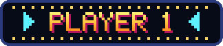</h3>

<p align="center">
  I make games that run in a browser tab — from <b>13 KB jam entries</b> to an <b>online RTS with its own game server</b>.<br>
  TypeScript on the client, Node or .NET on the server, and a soft spot for armies, rockets and pixel art.
</p>

```text
PLAYER 1 ........ Santi Herranz
CLASS ........... Web game developer
BASE ............ Barcelona
SPECIAL MOVE .... Real-time multiplayer, server-authoritative
ACHIEVEMENTS .... js13kGames entrant 2021 · 2022 · 2023 · 2024
STATUS .......... Open to work & collabs  ▶  see INSERT COIN
```

<h3 align="center">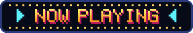</h3>

<p align="center">
  <a href="https://santiherranz.itch.io/tiny-swords-wars">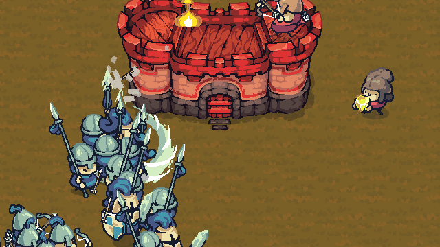</a>
</p>

<p align="center">
  <b>TINY SWORDS WARS</b> — a free 1v1 medieval RTS in your browser.<br>
  You don't click every soldier: you draw the front, conquer the provinces and raze the rival castle.
</p>

<p align="center">
  <a href="https://santiherranz.itch.io/tiny-swords-wars"></a>
</p>

<p align="center">
  <sub>Early access · Ranked Season 1 from 1 Nov 2026 · Colyseus + PixiJS · Art: <a href="https://pixelfrog-assets.itch.io/tiny-swords">Tiny Swords</a> by Pixel Frog</sub>
</p>

<h3 align="center"></h3>

<table>
<tr>
<td width="46%" valign="top">
<a href="https://santiherranz.itch.io/tiny-swords-wars">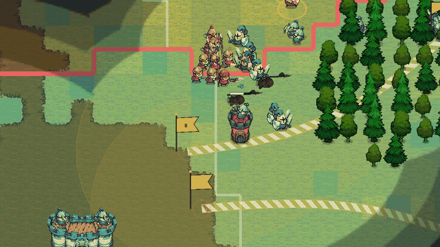</a>
</td>
<td valign="top">
<b>Under the hood of Tiny Swords Wars</b>
<ul>
<li><b>Server-authoritative netcode</b> on Colyseus: quick match, private 4-digit rooms, rematch and a 20 s reconnect window.</li>
<li><b>Real fog of war</b>: the server only sends what your side can see. No map hacks.</li>
<li><b>Bots that play fair</b>: Easy, Normal and Hard, with your rules and your vision, waiting in the lobby 24/7.</li>
<li><b>Procedural kingdoms</b>: a new map every match, with provinces, rivers, forests and gold mines.</li>
<li><b>Ranked seasons</b>: everyone starts each season's table at 1000 points.</li>
</ul>
<sub>Before it came a reusable Colyseus + Canvas room template and online Battleship and Connect Four prototypes.</sub>
</td>
</tr>
</table>

<h3 align="center">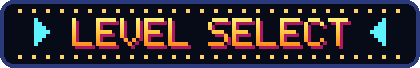</h3>

<table>
<tr>
<td width="50%" valign="top">
<a href="https://santiherranz.itch.io/rockets-and-drones-firefighter">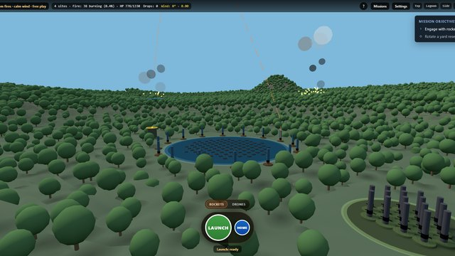</a>
<br><b>ROCKETS &amp; DRONES: FIREFIGHTER</b>
<br>Fight wildfires with tech from the future.
<br><sub>2026 · Three.js</sub>
<br><a href="https://santiherranz.itch.io/rockets-and-drones-firefighter"></a>
</td>
<td width="50%" valign="top">
<a href="https://santiherranz.itch.io/online-battleship">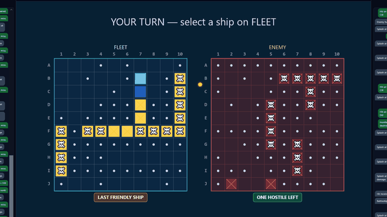</a>
<br><b>CLASSIC BATTLESHIP WITH AI ASSIST</b>
<br>The naval duel vs the CPU, with an optional AI hint and a leaderboard.
<br><sub>2026 · Canvas · Supabase</sub>
<br><a href="https://santiherranz.itch.io/online-battleship"></a>
</td>
</tr>
<tr>
<td width="50%" valign="top">
<a href="https://santiherranz.itch.io/rockfall-command">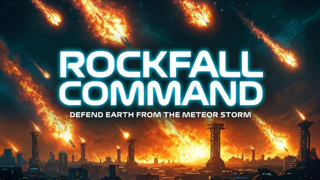</a>
<br><b>ROCKFALL COMMAND</b>
<br>My take on Atari's 1980 Missile Command: defend Earth from the meteor storm.
<br><sub>2025–2026 · Canvas · Supabase</sub>
<br><a href="https://santiherranz.itch.io/rockfall-command"></a>
</td>
<td width="50%" valign="top">
<a href="https://santiherranz.github.io/SumoFighters/">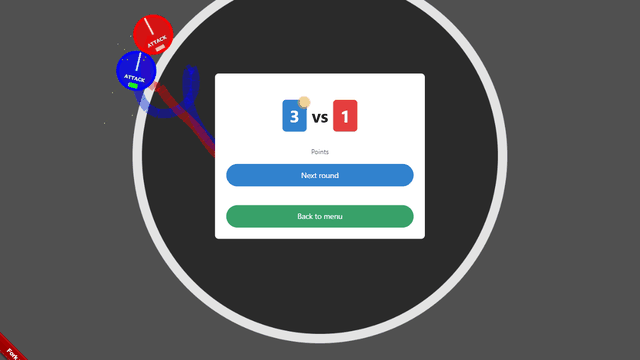</a>
<br><b>SUMOFIGHTERS</b>
<br>A robot sumo simulator for testing fight strategies.
<br><sub>2021 · JavaScript</sub>
<br><a href="https://santiherranz.github.io/SumoFighters/"></a>
<a href="https://github.com/santiHerranz/SumoFighters"></a>
</td>
</tr>
</table>

<h3 align="center">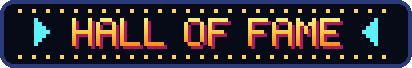</h3>

<p align="center">
  <a href="https://js13kgames.com/">js13kGames</a>: every year, a whole game in <b>13 kilobytes</b> zipped, built around a theme announced on day one.
</p>

<table>
<tr>
<td width="25%" valign="top" align="center">
<a href="https://js13kgames.com/games/rocket-cargo">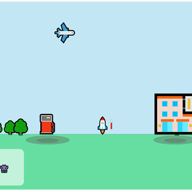</a>
<br><b>ROCKET CARGO</b>
<br><sub>2021 · theme: Space</sub>
<br><a href="https://js13kgames.com/games/rocket-cargo">Play</a> · <a href="https://github.com/santiHerranz/RocketCargo">Code</a>
</td>
<td width="25%" valign="top" align="center">
<a href="https://js13kgames.com/games/escape-from-death-hole">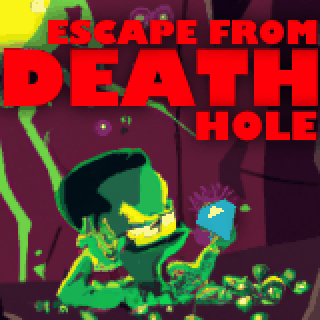</a>
<br><b>ESCAPE FROM DEATH HOLE</b>
<br><sub>2022 · theme: Death</sub>
<br><a href="https://js13kgames.com/games/escape-from-death-hole">Play</a> · <a href="https://github.com/santiHerranz/js13k2022-Death">Code</a>
</td>
<td width="25%" valign="top" align="center">
<a href="https://js13kgames.com/games/battle-commander-middle-ages">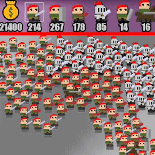</a>
<br><b>BATTLE COMMANDER</b>
<br><sub>2023 · theme: 13th Century</sub>
<br><a href="https://js13kgames.com/games/battle-commander-middle-ages">Play</a> · <a href="https://github.com/santiHerranz/js13k2023-Battle-commander-Middle-ages">Code</a>
</td>
<td width="25%" valign="top" align="center">
<a href="https://js13kgames.com/games/no-flight-zone-13">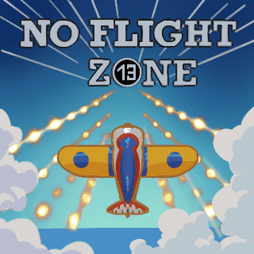</a>
<br><b>NO FLIGHT ZONE 13</b>
<br><sub>2024 · theme: Triskaidekaphobia</sub>
<br><a href="https://js13kgames.com/games/no-flight-zone-13">Play</a> · <a href="https://github.com/santiHerranz/js13k-2024">Code</a>
</td>
</tr>
</table>

<h3 align="center">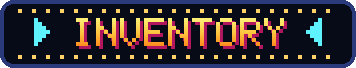</h3>

<table align="center">
<tr>
<td><b>Game</b></td>
<td>


</td>
</tr>
<tr>
<td><b>Netcode</b></td>
<td>


</td>
</tr>
<tr>
<td><b>Backend</b></td>
<td>


</td>
</tr>
<tr>
<td><b>Ship it</b></td>
<td>


</td>
</tr>
<tr>
<td><b>Tests</b></td>
<td>


</td>
</tr>
<tr>
<td><b>13 KB tricks</b></td>
<td>


</td>
</tr>
</table>

<h3 align="center">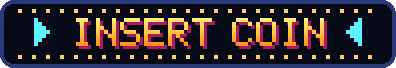</h3>

<p align="center">
  <b>Open to work</b>: freelance, contracts and game-jam teams.<br>
  Especially real-time multiplayer and anything that has to run in a browser tab.
</p>

<p align="center">
  <a href="https://santiherranz.itch.io/"></a>
  <a href="https://x.com/santiherranz">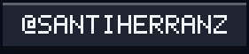</a>
</p>

<p align="center">
  
</p>
